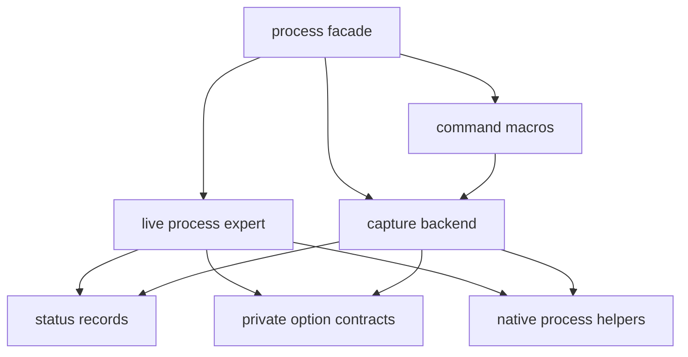

# System APIs

Import `(cspp system)` for the complete system API, or use the focused libraries below.
`(cspp)` includes the same public bindings. API details also appear immediately above their
implementations in `src/cspp/system/`.

| Library | Responsibility |
| --- | --- |
| `(cspp system process)` | Commands, captured results, live processes, pipes, and pipelines |
| `(cspp system signal)` | Signal names, sending, native thread masks, and synchronous waiting |
| `(cspp system user)` | Unix credentials, account lookup, and user/group records |
| `(cspp system filesystem)` | Filesystem capacity and mounted-filesystem records |
| `(cspp system info)` | Platform and host information, CPU count, and thread sleeps |
| `(cspp system errors)` | System conditions and their constructors/accessors |
| `(cspp system linux)` | Linux procfs and OS-release information |

Linux is the supported build platform. Native process helpers contain Unix/Darwin paths, but
these do not establish support for a complete Darwin build. Signal discovery, masks, and waits
currently support Linux. Darwin/Windows information helpers are documented stubs that raise
`system-unsupported-error?`. `mounted-filesystems` reads Linux `/proc/self/mountinfo` and returns
an empty list when that file is absent.

`hostname` (also `system-hostname`) and `cpu-arch` return strings. Native query failures raise
system conditions with the operation and error code.

`cpu-count` reports CPUs allowed by the calling native thread's affinity mask on Linux.
When affinity information is unavailable, it uses the online CPU count, falling back to one.
CPU-time quotas are not converted into CPU counts.

`sleep`, `milisleep`, and `nanosleep` accept exact nonnegative durations in their respective
units. The whole-second component must fit the native `time_t` range; larger durations raise
an argument error. The `sleep-seconds`, `sleep-milliseconds`, and `sleep-nanoseconds` aliases
have the same limits. These helpers preserve Chez Scheme's sleep behavior: a signal may
interrupt the pause and cause an early return, even if its handler returns normally.
Interrupted sleeps are not retried. For a minimum elapsed duration, callers should check a
monotonic deadline and sleep for the remaining time after an early return.

`linux-system-uptime`, `linux-memory-info`, and `linux-load-average` read their requested procfs
files directly on each call. They do not enumerate mounts or cache mount-namespace state.
An absent file raises `system-unsupported-error?`. `linux-procfs-mounted?` remains the explicit
mount-table query for checking whether procfs is mounted at `/proc`.

`linux-memory-info` returns an alist of symbol keys and exact integer values. Keys preserve the
kernel's field names: `(symbol->string (car entry))` gives the original name. Chez may print the
symbol for `Active(anon)` as `Active\x28;anon\x29;`; these escapes encode the parentheses and are
not part of its name. `(assq (string->symbol "Active(anon)") (linux-memory-info))` selects that field.
Values labeled `kB` by Linux are KiB; unitless fields such as `HugePages_Total` are counts.
The API leaves values in their reported units.

`linux-os-release` returns symbol/string associations from `/etc/os-release`, falling back to
`/usr/lib/os-release`. It decodes shell quoting and backslash escapes while preserving variable
references and command substitutions as literal text.
Repeated keys return only their final value, in order of each key's first appearance.

## Running commands

Do not use process operations inside fibers. Process execution and control APIs are native-thread
operations and are not integrated with the fiber scheduler. Fiber preemption can dispose an active
native operation, so resuming the fiber can fail; blocking operations can also occupy its worker.
Run process work on a separately managed Scheme thread outside the fiber scheduler. Disabling
fiber preemption does not provide supported fiber integration.

Process creation uses `process-<operation>[-<target>]` names:

| Behavior | Executable and arguments | Shell command string | Pipeline specifications |
| --- | --- | --- | --- |
| Return live handles | `process-spawn` | `process-spawn-shell` | `process-spawn-pipeline` |
| Wait for exit status | `process-run` | `process-run-shell` | `process-run-pipeline` |
| Wait and capture output | `process-capture` | `process-capture-shell` | `process-capture-pipeline` |

Direct execution also provides `process-run/check` and `process-capture/check`. These are the
current API names; the previous names are not exported as aliases.

Command forms take a program followed by arguments and then optional `:keyword value` clauses.
These are macros, not procedures with keyword parameters. A bare identifier in a command position
becomes literal text. Wrap a variable in `(begin variable)` to evaluate it.

```scheme
(import (cspp))

(define text "hello")
(define result (process-capture printf "%s" (begin text)))
(string=? "hello" (process-result-stdout result)) ; => #t
(process-exit-success? (process-result-status result)) ; => #t
```

`process-run` returns an exit-status record. `process-capture` returns a process-result record.
Neither invokes a shell. `process-run-shell` and `process-capture-shell` instead take one command
string interpreted by `sh -c`; construct shell text carefully when it includes external input.

Command names without `/` are searched in the child's `PATH`, using `/bin:/usr/bin` when it is
unset. Relative entries use the child's working directory. Failed candidates such as directories,
unexecutable files, and scripts with missing interpreters permit trying later entries. Explicit
paths bypass this search. The kernel handles shebangs; direct execution has no automatic shell
fallback for executable text without a shebang.

All process creation APIs close unrelated descriptors in the child before running the executable.
Only standard input, output, and error follow the stream options; parent descriptors stay open.
On Linux, this requires either the `close_range` syscall or readable `/proc/self/fd` enumeration.
If neither is available, launch raises a system error with `ENOTSUP`. A resource-limit sweep
cannot guarantee closure because limits can be lowered below descriptors that are already open.
Caught signal dispositions are reset before child setup; signals are blocked across `fork` until
that reset is complete. Explicitly ignored signals remain ignored, except `SIGPIPE`, which is
restored to default so commands terminate normally on broken pipes. The parent's handling is unchanged.
Children inherit the spawning native thread's signal mask; blocked signals remain blocked.

The `/check` variants require exit code zero by default. Ordinary variants accept any status.
The `:success` option overrides either default: `#f` accepts any status, a list accepts only normal
exits with one of those codes, and a callback `(status -> object)` accepts a nonfalse result.
The callback receives one process-exit-status record and runs once after completion.
Callback exceptions propagate to the caller. A rejected status raises `system-exit-error?`.
For capture forms, that condition's context includes a `result` association containing the
completed process result, with its captured streams, status, command, and pid:

```scheme
(define rejected-result
  (guard (failure [(system-exit-error? failure)
                   (cdr (assq 'result (system-error-context failure)))])
    (process-capture/check sh "-c" "printf diagnostic >&2; exit 7")))
(process-result-stderr rejected-result) ; => "diagnostic"
```

| Option | Values and default |
| --- | --- |
| `:cwd` | Nonempty directory string, or `#f` to inherit the working directory; default `#f` |
| `:env` | Alist of string pairs replacing the environment, or `#f` to inherit; default `#f` |
| `:env-mode` | Only `replace`; replacement is already implied by a supplied environment |
| `:stdin` | String, bytevector, `null`, `inherit`, or `#f`; default `null` |
| `:stdout` | `inherit`, `null`, or `capture`; default `inherit` for run, `capture` for capture |
| `:stderr` | The stdout choices plus `stdout` to merge; defaults follow `:stdout` above |
| `:encoding` | `utf-8` for captured strings, or `binary` for bytevectors; default `utf-8` |
| `:timeout` | `#f` or an exact integer from 0 through 2147483647 milliseconds; default `#f` |
| `:success` | `#f`, a proper list of exact exit codes from 0 through 255, or a status callback |

Stream defaults are chosen independently: setting `:stdout null` does not change stderr's
default. Capturing a stream with a run form drains its pipe without accumulating output data.
Omitted stdin is connected to `/dev/null`; `inherit` connects the child's stdin to OS descriptor 0.
Payload strings are UTF-8 encoded and may contain NUL; bytevectors pass arbitrary bytes.
Other OS strings—programs, arguments, directories, and environment names/values—must contain no
NUL. Environment names must also be nonempty and contain no `=`. `:env '()` clears the environment.

Captured output is buffered in memory until completion. For large or unbounded output, use live
ports. Choose binary capture for data that may not be valid UTF-8.
Uncaptured result streams are `#f`; a captured empty stream is `""` or an empty bytevector.
When stderr is merged into stdout, the stderr field is `#f`.
`process-result-command` is the program string for direct commands, the command string for shell
forms, or the symbol `pipeline` for a pipeline. `process-result-pid` identifies the completed child.

```scheme
(define binary-result
  (process-capture cat :stdin #vu8(0 255 1) :encoding binary))
(equal? #vu8(0 255 1) (process-result-stdout binary-result)) ; => #t

(define accepted
  (process-capture/check sh "-c" "exit 7" :success '(0 7)))
(= 7 (process-exit-status-code (process-result-status accepted))) ; => #t
```

A command timeout covers native I/O and waiting after the child starts; it does not bound
executable lookup or spawn setup. On timeout the helper closes its pipes and terminates and
reaps its immediate child before raising `system-timeout-error?`. Cleanup may take additional
time. Descendant processes are not terminated as a group. A descendant retaining a captured
output descriptor can keep capture waiting even after the immediate child exits.

## Live processes and port ownership

`process-spawn` is a procedure with positional arguments `(program arguments options)`.
`arguments` is a proper list of strings. `options` is an alist with `cwd`, `env`, `env-mode`, and
stream keys. The first three have the same meaning as their command-form options. Each stream
accepts `inherit` (the default), `null`, or `pipe`; stderr also accepts `stdout`.
Capture-only options such as `encoding`, `timeout`, and `success` are rejected here.

Piped stdin is a binary output port; piped stdout/stderr are binary input ports. Accessors return
`#f` for other stream modes. The caller owns these ports. Close stdin to send EOF, and drain output
as the child produces it. Waiting before draining a full output pipe can deadlock.
For arbitrary simultaneous input/output, use the capture forms or independent I/O threads.

```scheme
(define child (process-spawn "cat" '() '((stdin . pipe) (stdout . pipe))))
(dynamic-wind
  void
  (lambda ()
    ;; This bounded payload fits a pipe; larger exchanges need simultaneous reading/writing.
    (put-bytevector (process-stdin child) (string->utf8 "hello"))
    (close-port (process-stdin child))
    (let ([output (get-bytevector-all (process-stdout child))])
      (and (string=? "hello" (utf8->string output))
           (process-exit-success? (process-wait child))))) ; => #t
  (lambda ()
    (process-close-ports! child)
    (process-wait child)))
```

`process-wait` waits and caches the exit status. Concurrent waiters on the same process receive
the same cached record. `process-wait/no-hang` polls and returns `#f` while running.
`process-status` reads only the cache; `process-running?` polls and may reap an exited child.
`process-wait/timeout` accepts any exact nonnegative millisecond count and raises on expiry,
leaving the child running. It uses a monotonic deadline. None of these operations closes ports.
On Linux, each blocking or timed wait owns a transient pidfd when available. It sleeps until
exit notification or its deadline, then reaps under the process mutex. Concurrent waiters share
the cached result while owning separate notification descriptors. Descriptors are closed on
return or error; no background waiter is created. Unsupported or unavailable pidfds fall back
to short nonblocking polls and sleeps outside the mutex.
Native polls are bounded to 20 ms so both new and already-pending Scheme interrupts are serviced.
Timeout ticks do not trigger another `waitpid` call unless exit readiness is reported.
Interrupted waits resume against the original monotonic deadline.
Wait entry and exit run with interrupts disabled so a continuation escape during setup
cannot bypass cleanup of the notification descriptor.

`process-kill` takes a positive signed 32-bit signal number; `process-terminate` and
`process-interrupt` send TERM and INT. `send-process-signal` also accepts signal names/records.
These process-object operations synchronize with reaping and avoid signaling a completed
process. Avoid reaping the same child through a separate raw wait API.

`process-close-ports!` closes remaining open ports and may be called repeatedly. It neither
terminates nor waits for the process. It attempts every port before raising the first close error.
If flushing stdin fails, its remaining buffered data is discarded and closing is retried.
Port I/O and closing require caller coordination when the
same port is shared between threads. The per-process status mutex does not serialize port I/O.
`make-pipe` similarly returns two binary ports, input first and output second, both caller-owned.

`process-command` stores the executable string; `process-spawn-shell` therefore records `sh`,
with `"-c"` and the shell text in `process-arguments`. The argument list is copied when spawning,
but the strings and accessor results are shared mutable objects; coordinate mutations yourself.

## Pipelines and exit statuses

Pipeline specifications are nonempty proper lists of nonempty proper string lists, each starting
with a program. All OS string restrictions apply.
The parent closes connections as each stage starts, so its connection descriptor use stays bounded
as the pipeline grows.

```scheme
(define pipeline-result
  (process-capture-pipeline '(("printf" "hello") ("tr" "a-z" "A-Z"))))
(string=? "HELLO" (process-result-stdout pipeline-result)) ; => #t
(not (process-result-stderr pipeline-result)) ; => #t
```

`process-capture-pipeline` inherits stdin and stderr, captures only the final command's stdout as UTF-8,
waits for all children, and returns the final child's status and pid. `process-run-pipeline` also waits
for all children, discards final stdout without buffering, inherits stderr, and returns a list
containing the final status. These APIs have no timeout or binary-capture options and do not
implement pipefail: an earlier failure is not substituted for the final status.
If native capture fails, all remaining immediate pipeline children are terminated and reaped
before the original failure is raised.

`process-spawn-pipeline` takes the specifications and a reserved options argument that must be `'()`.
It returns a process object per command immediately, with no exposed stream ports. The first
stdin, final stdout, and all stderrs are inherited. Wait for each returned process to inspect
all statuses and reap every child.

An exit-status record has kind `exit`, `signal`, or `stopped`. Normal waits report completed
children as `exit` or `signal`; they do not request stop notifications. Codes are normal exit
codes or signal numbers, respectively. `process-exit-success?` accepts only `exit` with code zero.
`make-process-exit-status` is available from `(cspp system process expert)` for constructing
records; construction does not itself operate on a process.

## Signals and native threads

`signal` accepts a record, an exact positive signal number, a lowercase name symbol such as
`'term`, or a case-insensitive string with an optional `SIG` prefix. Common exported names
(`hup`, `int`, `quit`, `kill`, `usr1`, `usr2`, `alrm`, `term`, `chld`, and `pipe`) are symbol values.
Other names, including realtime names such as `'rtmin+1`, are available through `signal-list`.

```scheme
(signal-number (signal term)) ; => platform SIGTERM number
(string=? "SIGTERM" (signal->string (signal "term"))) ; => #t
(define previous-mask (signal-mask))
(dynamic-wind
  (lambda () (signal-block! '(usr1)))
  (lambda () (exists (lambda (sig) (eq? 'usr1 (signal-name sig))) (signal-mask))) ; => #t
  (lambda () (signal-mask-set! previous-mask)))
```

`send-signal` takes a positive process ID; `send-process-group-signal` takes a group ID greater
than 1. Group ID 1 is rejected because its native encoding would broadcast to unrelated processes.
Both accept the signal specifications above. `signal-mask` returns records blocked in the
calling native thread. `signal-mask-set!`, `signal-block!`, and `signal-unblock!` take proper
lists of specifications and return an unspecified value. SIGKILL/SIGSTOP cannot be masked;
runtime fault signals SIGSEGV/SIGBUS/SIGILL/SIGFPE have additional restrictions documented in
the source. `wait-signal` takes a nonempty list, requires every signal already blocked in the
calling thread, and returns one received signal record without changing the mask.

Masks belong to native threads, not fibers. Fibers can migrate, so configure masks and perform
synchronous waits from deliberately managed OS threads. A process-directed signal can reach any
eligible native thread: block it in every eligible thread before delivery, often by arranging
the mask before creating those threads. `wait-signal` releases the calling thread from Chez GC
coordination during each bounded native wait; Scheme handlers run between steps. It does not
install a Scheme callback or yield a fiber worker.

## Accounts, filesystems, and errors

`user-ref` and `group-ref` take exact unsigned 32-bit IDs or NUL-free name strings and return
fresh records. Lookup uses reentrant native account services. Missing entries raise
`system-not-found-error?`; `/default` variants return their supplied default only for missing
entries. `user-exists?` and `group-exists?` likewise return `#f` only for absence, propagating
other errors. Records retain caller-visible strings; group members are a vector of names or
`#f` when no members are listed. `current-user` and `current-group` use real IDs; effective IDs
are available separately through `current-euid` and `current-egid`.

`filesystem-info` queries a NUL-free path. Byte-count helpers multiply the reported fragment
size by total, free, or unprivileged-available blocks. Capacity is a snapshot, and the optional
filesystem type may be `#f`. Slow native filesystem queries permit other Scheme threads to collect.
Capacity and device identity come from one resolved target even if the path is replaced during
the query. On Linux, the query needs no file read permission and does not open device or FIFO streams.
Mount records expose source, target, type, and mount plus superblock
options separated by a space.

System conditions expose operation, code, message, and an association-list context. They also
provide standard `condition-who` and `condition-message` fields, so ordinary Chez handlers can
read them. An unknown operation has caller value `#f`.
Native helpers use `ffi-result-ref` to decode `ok`, `errno`, `not-found`, `unsupported`, and `timeout`
vectors. Permission errors specialize errno 1 and 13. Exit errors instead describe an
unaccepted process status. Context keys may be symbols in Scheme or strings in native results.
Native error messages are decoded using the calling thread's locale, including non-UTF-8 locales.

CSPP `getenv`/`putenv`, native environment readers, and inherited process snapshots share a lock.
Direct libc/Chez environment mutation outside these wrappers requires caller synchronization.
Raw `fork` remains unsafe in a threaded Scheme runtime. `vfork` raises
`system-unsupported-error?` without creating a child: returning through the C wrapper and Scheme
FFI stack would corrupt the parent's shared state. Use `process-spawn` to launch executables.

## Implementation boundaries

The process facade assembles three paths without owning execution state:



Status records contain values only. The private option module validates shared contracts and
converts directory defaults. Live process objects own status caches and mutexes; the capture
backend owns completed result records. Account lookups use the same tagged FFI error decoder,
without a second legacy error protocol.

Each spawn, capture, or pipeline invocation owns one resumable native operation. Preparation
copies Scheme inputs; steps use only native buffers, strings, descriptors, and child IDs.
The shared state machine performs exec handshakes, feeds stdin, drains outputs, and reaps children.
Run forms disable retention for discarded capture streams. Connections remain bounded as stages
launch. There is no global reactor, extra thread, or native callback into Scheme.
After I/O finishes, completed commands use one transient pidfd at a time to wait for remaining
children, including earlier pipeline stages. If pidfds are unavailable, short polls are used.

The private `(cspp system native)` wrapper owns each operation in a `dynamic-wind` scope.
Steps poll for at most 20 ms and return for a Scheme event check; blocking OS setup calls and
cleanup can take additional time. Signal waits use the same wrapper with `sigtimedwait` steps.
Scalar-only step and disposal calls use `__collect_safe`, letting Chez deactivate/reactivate the
thread while other threads collect. Scheme result allocation and resource publication happen
only while active. A handler escape closes owned descriptors and kills/reaps unreturned immediate
children; normal live spawning transfers ownership to the returned process objects.
Live spawns, live pipelines, and `make-pipe` retain Scheme cleanup across continuation exits
during handoff. Once acquisition completes normally, callers own the resources. A caller whose
interrupt handlers can escape must protect acquisition and storage of the result together with
`with-interrupts-disabled`, and arrange cleanup for its own subsequent continuation exits.
Once a native operation's scope has been left and disposed, replaying a continuation into it raises
an error. Resuming live `process-wait` instead acquires a fresh notification descriptor.
Continuations into either kind of operation must stay on their original Scheme thread; cross-thread
entry raises an error so two threads cannot share or free one invocation's native state.

Live waits use pidfds when available and reap under the per-process mutex after exit notification.
Their polls also have the 20 ms bound, while reaping remains tied to readiness. These are native
thread operations. Do not use process operations inside fibers; the periodic event checks and GC
cooperation do not make their native-resource lifetime compatible with fiber suspension.
